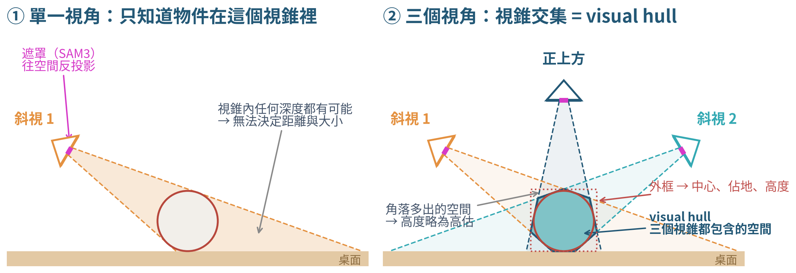

# fr3-scan2cad

FR3 三爪手臂用腕部相機自動掃描桌上物件，輸出**公尺尺度 CAD**（TRELLIS）與物件的 **visual hull 座標**（機器人基座座標），全程錄影。

只輸入物件名稱（例如 `"mug"`），流程全自動：

1. **相機標定**：16 個手臂姿態拍 AprilTag 板，求內參、畸變、手眼、板在基座的位置（Zhang + Park + BA）
2. **俯視偵測**：高處俯視整張桌面，SAM3 / YOLOE 依文字找到目標
3. **Visual hull**：正上方 + 3 個環繞斜視（左前、右前、背面；IK 不可達時自動換方位、仰角、距離），遮罩反投影雕刻 → 物件中心、佔地、高度
4. **TRELLIS v1**：**直接沿用第 3 步的 4 張照片**（去背、轉正），不再另外繞一圈拍 → mesh
5. **對齊 visual hull**：把 TRELLIS mesh 的尺度 s、旋轉 R、平移 t 對到 visual hull（3D：mesh 在 hull 內且填滿 hull；預設再加上投影輪廓 = hull 所用遮罩），放在桌面上
6. **輸出**：CAD（mm STL / 基座座標 GLB）+ visual hull 點雲、外框、中心（桌面與基座座標）
7. **影片合成**；流程全部結束後才用模擬真值**評分**

舊的「定位後另外環繞拍 4 張」流程仍保留：scan 設定 `locate.hull_views_as_trellis_inputs: false`。



## 模擬器只當硬體

Isaac Sim 只扮演實機：關節編碼器、關節命令、腕部 RGB 相機，外加一台拍全程的場景相機。
`scan2cad/`（brain）只拿得到 **RGB 影像 + 關節角**，其他一律自己估：

| 實機會需要的 | 本流程怎麼得到 |
|---|---|
| 相機內參 K、畸變 | AprilTag 板多姿態 Zhang 標定 |
| 相機裝在手上哪裡 (hand-eye) | CAD 粗估 → Park → 重投影 bundle adjustment |
| 桌子 / Tag 板在手臂座標的位置 | 同一個 bundle adjustment 一起估 `base_T_board` |
| 物件在哪、多大 | 開放詞彙分割 + 多視角輪廓雕刻 (visual hull) |
| 手臂運動學 | FR3 規格書 DH 參數 |
| 物件 6D 位姿 + 公尺尺度 | TRELLIS mesh 對齊 visual hull（+ 其遮罩輪廓） |

**不使用任何模擬真值。** `scan2cad/scanner.py` 裝了 audit hook，試圖讀 `sim_private/`、`configs/scenes/` 或錄影檔會直接報錯。
模擬器結束時才把真值寫到 `sim_private/`；`eval/evaluate.py` 先把所有輸出 SHA256 凍結，才打開真值評分。
接實機時，只需把 `scanner.py` 裡的 `Robot` 類別（`move / capture / q`）換成 franky(libfranka) + 相機驅動。

## 目錄

```
scan2cad/        brain：只用 RGB + 關節角（.venv 執行）
  scanner.py       步驟 1–3 主流程與 Robot RPC 客戶端
  detect.py        YOLOE-26 / SAM2.1 / SAM3
  vision.py        AprilTag、PnP、投影、visual hull、轉正
  kinematics.py    FR3 DH、FK、DLS IK
  register.py      步驟 5–6 對齊 visual hull、輸出 CAD 與 hull
  video.py         過程影片合成
generate/        TRELLIS v1 推論（TRELLIS 自己的 venv 執行）
sim/             Isaac Sim 硬體替身（Isaac 的 python.sh 執行）
common/          brain ↔ 硬體 RPC 協定、路徑設定 (.env)
eval/            唯一允許讀 sim_private/ 的地方
configs/scenes/  模擬世界（brain 禁止讀取）
configs/scans/   brain 設定：prompt、偵測器、視角規劃
assets/          AprilTag 貼圖、木紋
scripts/         run.py（一行跑完）、run_multi.sh、download_weights.sh
tools/           報告用圖（visual hull 示意圖）
tests/           運動學與幾何單元測試
docs/results/    三物件實驗的 CAD 預覽、位姿、評分
```

## 安裝

1. **brain 環境**（Python 3.11）：`python3.11 -m venv .venv && .venv/bin/pip install -e .`
2. **權重**：`scripts/download_weights.sh`。SAM3 需先在 Hugging Face 同意授權並 `hf auth login`。
3. **Isaac Sim 6.0.1** 與 **TRELLIS v1**：各自的環境，路徑寫進 `.env`。
4. `cp .env.example .env`，填入：
   - `ISAAC_PYTHON`、`TRELLIS_PYTHON`、`TRELLIS_ROOT`
   - `ROBOT_USD`、`GRIPPER_POSES`：FR3 三爪資產
   - `ISAAC_ASSET_ROOTS`：Isaac 6.0 資產樹，可用冒號列多個；場景設定的 `isaac://...` 會依序搜尋

## 執行

```bash
.venv/bin/python scripts/run.py --scene configs/scenes/mug.json --scan configs/scans/mug.json
# 沿用既有標定（省 ~2 分鐘）
.venv/bin/python scripts/run.py --scene ... --scan ... --calibration runs/<上次>/calib/calibration.json
# 只重做後段（不需 Isaac）
.venv/bin/python scripts/run.py --out runs/<run> --from-stage register   # trellis|register|video|evaluate
# 看 Isaac 視窗：加 --gui
# 三物件實驗
scripts/run_multi.sh
# 測試
.venv/bin/python tests/test_kinematics.py && .venv/bin/python tests/test_vision.py
```

輸出 `runs/<時間>_<prompt>/`：

```
process.mp4                    全程影片（場景相機 + 腕部即時 + 感知疊圖 + 4 張拍攝 + TRELLIS + CAD 轉台）
calib/calibration.json         K、畸變、link8_T_cam、base_T_board、重投影誤差
locate/                        偵測、visual hull 點、object_estimate.json
views/ inputs/                 TRELLIS 輸入（= visual hull 照片）RGB / 遮罩 / 轉正後 RGBA 與相機位姿 (views.json)
trellis/                       TRELLIS 原生 mesh
cad/object_cad_mm.stl          物件中心座標、mm（原點 = 桌面上物件底部中心）
cad/object_robot_base_frame.*  機器人基座座標（可直接給抓取規劃）
cad/visual_hull.json           visual hull 中心、外框（桌面與基座座標）、體積
cad/visual_hull_*_frame.ply    visual hull 體素點（公尺）
cad/pose_and_scale.json        6D 位姿、尺度、輪廓 IoU、與 hull 的偏差、各對齊方式比較
cad/alignments/                hull-only 與 hull+silhouette 兩種對齊結果
process_with_eval.mp4          上面的影片 + 第 8 段驗證（CAD 與真值同座標重疊轉台、誤差熱圖、真值投影回照片）
eval/evaluation.json           （僅事後）CAD、各對齊方式、visual hull 與模擬真值比較
```

## 結果（2026-11-10，visual hull 照片當 TRELLIS 輸入，三物件隨機擺放，Isaac Sim）

| 物件 | visual hull 水平誤差 | 輪廓 IoU | Chamfer | F@5mm | CAD 尺寸 估計 / 真值（mm） |
|---|---|---|---|---|---|
| 棒球 | 1.8 mm | 0.973 | 3.05 mm | 0.79 | 84×85×84 / 89×90×88 |
| 番茄湯罐頭 | 2.5 mm | 0.932 | 3.18 mm | 0.92 | 62×63×107 / 68×69×103 |
| 馬克杯 | 4.2 mm | 0.933 | 2.32 mm | 0.98 | 106×94×115 / 115×98×111 |

上一版（定位後另外環繞拍 4 張）：Chamfer 棒球 3.1 / 罐頭 2.7 / 馬克杯 2.3 mm。罐頭第一個 TRELLIS seed 形狀壞掉（輪廓 IoU 0.53），由 `scripts/run.py` 的自動重試（IoU < 0.85 換 seed）修正。
每次執行另輸出 `process_with_eval.mp4`：影片最後一段把 CAD 與真值放在同一座標重疊驗證（`eval/verify_video.py`）。

## 已知限制

- 避碰只考慮桌面與目標物件，沒有把其他偵測到的物件加入碰撞檢查；碰撞模型是連桿點 + 圓柱禁區，不是完整 mesh。
- 高空俯視 0.8 m 從 home 姿態 IK 無解，已改 0.75 m，尚未重跑完整流程驗證。
- SAM3 遮罩邊緣偏緊，棒球、罐頭尺寸偏小 5–9%。
- DLS IK 在約 8–12% 的可達姿態停在 1–4 mm 誤差、未達 1 mm 門檻（見 `tests/test_kinematics.py`），規劃器會改用其他視角。
- 物件底部從未拍到，由 TRELLIS 自行補。輸出是三角網格（STL/GLB/OBJ），不是參數化 B-rep (STEP)。
- `scan2cad/video.py` 使用系統字型 `/usr/share/fonts/opentype/noto/NotoSansCJK-Bold.ttc`。
